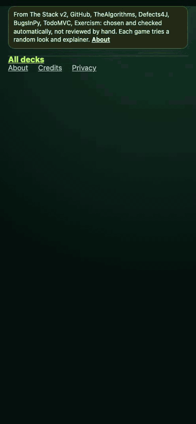
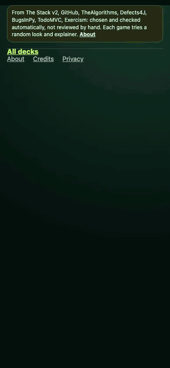
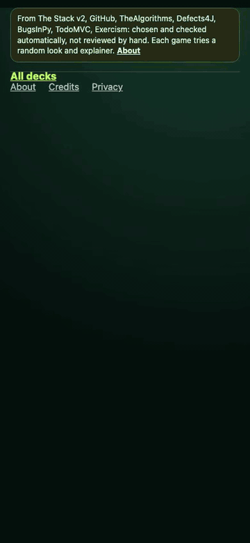
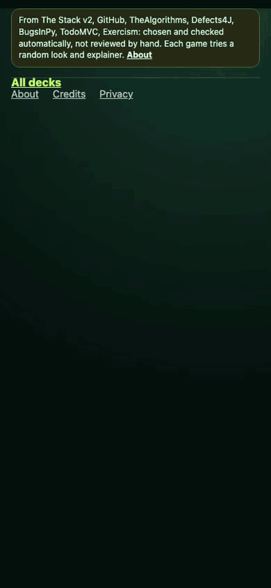
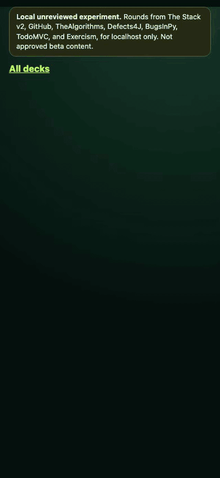
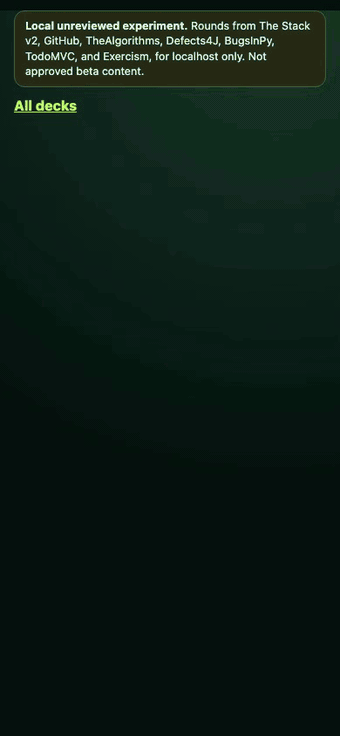
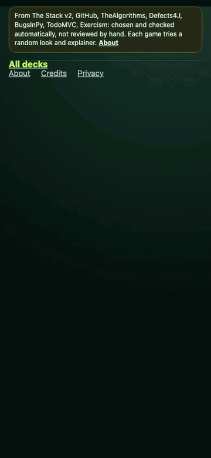

# CodeGuessr

[](https://github.com/MysterionRise/code-guesser/actions/workflows/ci.yml)

CodeGuessr is “GeoGuessr for code”: read an unfamiliar excerpt of real
open-source code, reveal clues if you need them, and guess.

The current release is v1.0.0: [release notes](docs/releases/v1.0.0.md).

## See it in action

<p align="center">
  
</p>

The demo plays one round from seven of the ten decks and gets every answer
right. It shows three of the four themes and both question layers (Trace it
and Marker hunt). Below is one clip per deck.

**Recognise:** tell where code comes from.

<p align="center">
  
  
  
</p>
<p align="center">
  
  
</p>

**Reason:** work out what code does.

<p align="center">
  
  
  
</p>
<p align="center">
  
  
</p>

All clips were recorded on 2026-10-19 from the v1.0 artifact prepared that
day, so they show v1.0 rounds; the v7 artifact's clips come next (#167). A
[sped-up full run](docs/media/full-run.gif) and a normal-speed
[MP4](docs/media/codeguessr-demo.mp4) play a mixed game, one round from each of
five decks, from the deck chooser and back. All are regenerated by
`pnpm demo:record`; see [Recording the demo](#recording-the-demo).

## What you play

The root route is a deck chooser with ten decks, tagged "Recognise" or
"Reason". Each holds a pool of real rounds, 422 in all, prepared from public
code by the v7 data run on 2026-10-21
([evidence](docs/review/evidence/2026-10-21-v7-data-run.md)):

- 48 rounds each of project, algorithm, name the function, and exercise;
- 52 language rounds, over 26 languages;
- 30 before-or-after rounds;
- 40 rounds each of output and missing line;
- 36 fix rounds;
- 32 framework rounds.

Every game deals five rounds from the pool at random. Four-option rounds
reshuffle their options each time, except fix rounds, whose lines stay in line
order. A deck's address carries its deal (`&deal=<seed>&game=<n>`), so a
reload shows the same game, and "Deal new rounds" moves to the deal's next
game, which shares no round with the earlier ones until the pool is spent.

| Deck | You see | You pick from | Source |
| --- | --- | --- | --- |
| Which project? | code from a popular repository, past its imports | four popular repositories in the same language, with their descriptions | The Stack v2 (popularity by GitHub star events), Software Heritage blobs, revalidated on GitHub |
| Which language? | a file excerpt, past its imports | two look-alike pairs, one of them the answer's (such as C and C++ with Java and C#) | The Stack v2, Software Heritage blobs |
| Before or after? | the same stretch of a file before and after a refactor commit | which version is newer | GitHub commit search; the answer is the commit's recorded parent |
| Which algorithm? | a classic algorithm with its own names hidden as `mystery` | the four algorithms of one family, such as four sorts or four searches | TheAlgorithms in Python, Go, and Java at pinned commits; the answer is where the repository files the code |
| Predict the output | a short Python function and one call of it | four results the same function returns for different calls | TheAlgorithms/Python doctests, read as text and never run; the repository's CI checks them at the pin |
| Spot the fix | 14 numbered lines just before a real one-line bug fix | four lines, each showing its code | Defects4J and BugsInPy bug records, confirmed against each upstream fix commit; the code comes from the upstream repository |
| Missing line | a function with one line hidden | four lines from the same file | TheAlgorithms/Python at a pinned commit |
| Name the function | a function with its name hidden as `mystery` | four names its author might have given it | TheAlgorithms in Java and Go at pinned commits |
| Which framework? | a file of a to-do app, every framework's own names hidden | four frameworks of one family, such as four component libraries | tastejs/todomvc, the same app written in each framework |
| Which exercise? | a reference solution with the exercise's names hidden | four exercises of one family, such as four word puzzles | Exercism's Python, Go, Rust, Ruby, JavaScript, and C# tracks |

Hints cost points. A correct answer is worth 1,000, 800, or 500 points after
zero, one, or two hints on a four-option round, and 500, 400, or 250 on a
two-option round, so guessing at random earns the same 250 a round on every
deck. After you answer, the reveal highlights the right option and explains
it under "Why". The round dots mark each answered round ✓ or ✗, and a
finished game lists every round, your pick, the answer, the points, and its
source.

"Share result" passes on a spoiler-free line: the deck, the tally, one square
per round (🟩 right with no hint, 🟨 right with hints, ⬛ missed), and the
game's own address, so a friend is dealt the same five. A browser with a share
sheet opens it (Web Share); any other copies the line to the clipboard:

```text
CodeGuessr · Which language? · 4/5 · 3,800/5,000
🟩🟨⬛🟩🟩
http://127.0.0.1:3000/?deck=language&deal=0a1b2c3d&game=0
```

The link carries the deck, the deal's seed, and the game number, never a
lab pick. A deck's address also gives link previews its title, description,
and an image of its title (`/og/<deck>`), never anything from a round.

From the keyboard, `1` to `4` pick an option, `Enter` locks it in, `H` buys a
hint, and `N` moves to the next round. On a phone, "Wrap lines" wraps long
code under each line's own indentation.

`/?deck=<id>` opens a deck directly: `project`, `language`, `before-after`,
`algorithm`, `output`, `fix`, `missing-line`, `name-function`, `framework`,
or `exercise`. An id this artifact doesn't hold shows the chooser under a
note that the deck isn't available.

A notice above every page names the sources, says the rounds are chosen and
checked automatically, not reviewed by hand, and links `/about`: how to play,
scoring and keys, every deck by its own description, duels, and what the
experiment draws and records. Any other address gets a 404 page with the way
back to the decks. `robots.txt` lets crawlers read the chooser and About but
never a deck's or a duel's address, since those deal a game or open a duel.
With `CODEGUESSR_PUBLIC_ORIGIN` set, every page's link preview resolves
against it.

Two cards come first in the chooser:

- **Today's five** (`/?deck=daily&date=2026-10-22`) deals a mixed game seeded
  by the artifact and the player's own date. The browser adds its date to a
  bare `/?deck=daily`, which deals nothing itself. Every load of a date deals
  the same five rounds in the same order, and its share line and link carry
  the date. The server deals a date only within a day of its own UTC date,
  which covers every time zone from UTC−12 to UTC+14, and refuses any other.
  Once a game is done, "Play again" deals the same five again
  (`&replay=1`) and records no events.
- **Mixed** (`/?deck=mixed`) deals one round from each of five decks drawn at
  random. Each round's header names its deck, and the game scores up to the
  sum of its rounds' top points.

Each card also shows your records once you've finished a game of it, such as
"Best 3,250 · streak 4". A streak counts games in a row with at least three of
five right. Today's five shows a day streak ("Day streak 3"): the days in a
row, by your own date, on which you finished it. It counts once a day.
A friend's game of a duel counts toward its deck like any other.

Records live only in your browser's local storage, under the key
`codeguessr.records`. Nothing about them reaches the server, and there is no
account. They start afresh when the round set changes. "Clear records", under
the decks, forgets them after asking. A browser that refuses storage, such as
some private windows, plays the same and keeps none.

A leakage test (`packages/artifact/test/deck-leakage.test.ts`) checks that
solvers which never read the code, or only skim it, stay within chance plus
ten points:
- option frequency;
- position;
- the largest, smallest, longest, or shortest option;
- the line nearest the middle;
- an option's label words or stems found in the algorithm code;
- the fix line with the most or least length, operators and brackets,
  indentation, or words used once, a line of prose, and the longer line of
  the second hint's pair.

Every theme passes axe's WCAG 2 A and AA rules on a round, a revealed round,
an explainer panel, and the chooser (`tests/e2e/themes.spec.ts`), and every
text colour reaches 4.5:1 on its background (`theme-tokens.test.ts`).

A simulated player who never reads code but remembers every reveal must
stay within three points of what replaying reveals alone earns, in games
two and three, and no language option set appears in more than two rounds
(#81).

One known leak waits for new source data and runs as an expected failure:
a player who remembers a family deck's reveals (algorithm, framework, or
exercise) can rule out members already answered and beats replaying reveals
by more than three points (#81). Answering each algorithm twice (v7) halved
that gain on the algorithm deck.

The rounds are prepared automatically and not reviewed by hand. The game is
served on localhost today; anonymous public play on one instance comes with
v1.1, once the launch gates in #100 close.

## Play locally

Prerequisites: Node.js `24.22.0` and pnpm `9.15.9`. `.nvmrc` and `.node-version`
pin the Node version, so `nvm use` or `fnm use` picks it.

```bash
pnpm install --frozen-lockfile
pnpm --filter @codeguessr/game dev
```

Open [http://127.0.0.1:3000](http://127.0.0.1:3000). The server listens on
127.0.0.1 only, so other machines on the network cannot reach it. If another
app holds port 3000, pick another port with `PORT`, such as
`PORT=3200 pnpm --filter @codeguessr/game dev`. The root route reads
`apps/game/src/demo/generated/local-real-rounds.json`, checks it against the
pinned hash in `apps/game/src/demo/local-real-experiment.pin.server.ts`, and
makes no network requests while you play. If the artifact is missing, has the
wrong hash, or is from an older format, the page says so and offers no rounds.
After preparing, rebuild and restart the game: the build compiles in the pin,
and a running server keeps the artifact it first read.

The server keeps score. Each game's progress travels as a token the server
signs, and hints and answers go through server actions. A round takes one
answer, the score and hint count are the server's own, and a hint's text
reaches the browser only once it is bought. Without
`CODEGUESSR_SESSION_SECRET` (at least 32 characters) the server signs with a
random secret, so a restart ends the games in progress: the page then asks
the player to deal new rounds.

The server remembers each game's latest step, so an older token can't answer
a round again. With `CODEGUESSR_STATE_DIR` it writes that step through to
`state.sqlite` in the directory (Node's own `node:sqlite`), so the rule holds
across a restart, and a game the file doesn't know has ended. Without it, the
steps live in memory, and after a restart a game continues from whichever of
its tokens arrives first. Expired games are deleted after six hours.

`GET /api/health` answers `ok`, or 503 with one bare code:
`ARTIFACT_MISSING`, `ARTIFACT_HASH_MISMATCH`, or `ARTIFACT_SCHEMA` (the
rounds did not load), `STATE_DIR_UNWRITABLE`, `STATE_STORE_UNAVAILABLE`, or
`EVENTS_DIR_UNWRITABLE`. It reads nothing from the request and records
nothing.

A shared link and a link preview name the address the request came to.
Behind a proxy or on a public host, set `CODEGUESSR_PUBLIC_ORIGIN` (such as
`https://codeguessr.example`) so they name that instead.

### Duels

"Challenge a friend", under any finished game of a deck, the mix, or today's
five, makes a challenge link such as `/?duel=<token>#from=Ana`. It opens on
an intro: who challenges, the deck, and the total to beat (`4/5 right ·
3,800 of 5,000`). The intro deals nothing, so a link preview never starts a
game. "Play the same five" deals the friend the challenger's very game: the
same rounds, option order, theme, and question layer. The server deals it
again and checks it against the challenge first.

During the game, a strip shows each of the challenger's rounds only once the
friend has locked that round, and the reveal says how the challenger did on
it. This is presentation, not secrecy: the page holds the challenger's
right-or-wrong, hints, and points for every round from the start, and never
an answer. A finished game ends on a comparison and a result link, such as
`/?duel-result=<token>#from=Ana&vs=Ben`, which shows both games read-only.
"Rematch" deals the deck afresh.

- **What a link carries:** a token encrypted (AES-256-GCM) under a key derived
  from the session secret. A challenge holds the deal, the challenger's arms,
  how each round went, and the best score. A result holds both games' rounds.
  Neither holds a round, an option, an answer, or a name.
- **Names:** a name is optional, and lives only in the part after `#`, which a
  browser never sends, so no name reaches the server or its logs. It is
  cleaned before it shows: letters, digits, spaces, `-`, `'`, and `_`, up to
  24, or else "A friend".
- **First try and plays:** the intro and the comparison say whether the
  challenger's game was their first of that deal on this server ("First try")
  or followed an earlier one. Today's five is everyone's game, so it says
  neither. A result says which play of the link it was ("Ben's 2nd play of
  this link").
- **Lifetimes:** a challenge deals for 7 days, and a result shows for 30. A
  result outlives the round set it was played on. A challenge for an earlier
  round set says so, and offers its deck afresh.
- **The secret:** duel links need a fixed `CODEGUESSR_SESSION_SECRET`. With
  the random secret a server makes without one, every link dies when it
  restarts.
- **Events:** a friend's game records events under the friend's own
  `Sec-GPC`, marked as a duel's (`origin: duel`), so the report keeps it out
  of the comparisons. The log hears that a challenge was made, that a link
  went out, and how the friend's game went against it; never a link, a name,
  or anything that ties the two games together.

To try it on one machine, finish a game, choose "Challenge a friend", copy the
link, and open it in a second tab. The tabs share nothing: the friend's tab
shows only what its own link carries.

### Credits and privacy

Every page's footer links two pages (#99):

- **`/credits`** lists every file the rounds show, grouped by licence and then
  repository. It is built from the committed artifact. Each repository links
  its licence file at the commit its files were read at, and each licence links
  its text on spdx.org.
  - A file's path often names its round's answer (`sorts/SelectionSort.java`),
    so a credit never names its round: no round id, deck, order, or hash.
  - [`docs/licences.md`](docs/licences.md) sets out what each allowed licence
    asks of excerpts. Apache-2.0's NOTICE files are an open judgment call.
- **`/privacy`** says what the game records and what it never records. It is
  rendered from `privacy/disclosures.ts`, a registry of what each feature keeps
  or sends: the event log, game progress, plays, share and duel links, browser
  storage (the local records' one key), the client address for rate limits, the model calls, server
  logs, and `Sec-GPC`.
  - The event log's part is the event schema in words
    (`experiment/event-docs.ts`), and a test holds its fields to the schema's.

### Public mode

`CODEGUESSR_PUBLIC=1` marks a server for anonymous public play (#100). It
refuses to start until it is configured for it: each missing or malformed
setting prints `GAME_ENVIRONMENT_REJECTED <CODE>`, never a value, and the
server exits with status 78.

| Variable | In public mode |
| --- | --- |
| `CODEGUESSR_PUBLIC` | `1` turns public mode on; any value but `1`, `0`, or empty is refused |
| `CODEGUESSR_SESSION_SECRET` | Required, at least 32 characters. A public server never makes one up |
| `CODEGUESSR_PUBLIC_ORIGIN` | Required: the https origin players use, such as `https://codeguessr.example`, with no path; shared links and link previews name it |
| `CODEGUESSR_STATE_DIR` | Required: an absolute directory for the server's own state, the session ledger's `state.sqlite` |
| `EXPERIMENT_EVENTS_DIR` | Required: an absolute directory for the event log |
| `CODEGUESSR_CLIENT_IP_HEADER` | Required: the header the reverse proxy sets to the client's address, such as `X-Forwarded-For`, for rate limits (#98) |
| `CODEGUESSR_RATE_LIMITS` | Optional: `on`, or a positive multiplier of every rate limit such as `2` or `0.5`; anything else is refused |
| `OPENROUTER_API_KEY` | Required when `GENUI_ENABLED=1` |
| `OPENROUTER_BASE_URL` | Unset or `https://openrouter.ai/api/v1`, unless `EXPERIMENT_SOURCE` is `agent` or `synthetic` |
| `EXPERIMENT_LAB` | Refused, unless `EXPERIMENT_SOURCE` is `agent` or `synthetic`; lab mode stays off for real games |
| `EXPERIMENT_DISABLED` | Only known `factor:level` pairs |

Every page carries a Content Security Policy with a fresh nonce per request
(`apps/game/src/middleware.ts`): only the scripts the server rendered for
that response run. Styles may be inline, nothing loads from another origin,
and no other site may frame the game. Responses also send `Referrer-Policy:
no-referrer`, `X-Content-Type-Options: nosniff`, `X-Frame-Options: DENY`,
`Cross-Origin-Opener-Policy: same-origin`, and a `Permissions-Policy` that
turns off the camera, microphone, location, payments, USB, and topics. A
public server also upgrades insecure requests and sends HSTS, for now with
`max-age=300`. The visualizer's page runs in its own frame route,
`/genui/frame`, under its own stricter policy.

A page that fails shows a plain error page with a link back to the decks; it
says nothing about the error. The `dev` and `start` scripts still listen on
127.0.0.1 only.

#### Rate limits

A public server limits each client (#98), and so does any server with
`CODEGUESSR_RATE_LIMITS` set; a local one, as for playtests and demo
recording, is never throttled. Each surface has a token bucket per client:

| Surface | Per minute | Burst | When it runs out |
| --- | --- | --- | --- |
| A deck's address (a deal, or its redirect to a fresh seed) | 20 | 10 | The page says "Too many new games — wait a minute" and deals nothing |
| A hint | 60 | 60 | The hint bar asks the player to wait a few seconds |
| An answer | 60 | 60 | The answer button does the same |
| The event beacon | 120 | 120 | 429; the event is dropped |
| Generative UI, per client | 10 | 4 | 429; the panel keeps the static reveal and reports `limited` |
| Generative UI, the whole server | 120 | 120 | The same |

A game may also make at most 12 explainer calls, and 8 host turns a round.
A client is the last address in `CODEGUESSR_CLIENT_IP_HEADER`, the one the
proxy appended, and an IPv6 client is its /64. The address is read in one
module (`apps/game/src/server/client-key.server.ts`) and kept only as a
salted hash in memory, for this process; it is never logged or stored. A
missing or unreadable header counts as one shared client. The buckets live in
the process, so they assume one instance.

### Generative UI (experimental)

Off by default. With `GENUI_ENABLED=1` and an OpenRouter key, a revealed round
offers an **Explainer**: a model annotates the code, lists the signals that
pointed to the answer and away from it, and gives a one-line takeaway.

```bash
GENUI_ENABLED=1 OPENROUTER_API_KEY=… pnpm --filter @codeguessr/game dev
```

- Each game draws its design at random when it is dealt, and keeps it (see
  [The design experiment](#the-design-experiment)). In lab mode, `?design=`
  picks one instead, and a "Designs" nav switches between them:
  - `catalog` fills five fixed components;
  - `composer` lets the model lay out the whole panel from 14 building
    blocks, ending in a quiz;
  - `visualizer` lets the model write a small interactive page that steps
    through the round's code. It runs in a sandboxed frame with no network
    and no access to the game;
  - `host` adds a chat beside the round. Before you answer, the host hasn't
    seen the code: it explains the rules and can offer you the next hint.
    After you answer, it talks about the code;
  - `off` plays the static game.
- `OPENROUTER_MODEL` picks the model (default `anthropic/claude-haiku-5.5`).
- Set spend limits on the OpenRouter key itself. When the key is refused, the
  explainer steps aside and the game plays on. A panel that fails offers
  "Try again" once.
- The model never sees a round's code before you answer, and it can only
  render a fixed set of components whose contents the server checks.
- Requests ask OpenRouter for providers that neither store nor train on
  prompts.
- The browser tests and unit tests use a local stand-in for OpenRouter, so
  they need no key.

### The design experiment

Each game draws one level of three factors when it is dealt, and the server
seals them into the game's token:
- **design:** off, catalog, composer, visualizer, or host;
- **theme:** Terminal (the original), Paper, Arcade, or High contrast;
- **question layer:** off or on. On, an algorithm or language round shows
  its question layer: a free scaffold above the code ("What to watch", or
  "Ask of the code") and generated hints, including a step-through.

The factors are drawn independently, so every game counts toward every
comparison, except a friend's game of a duel, which plays the challenger's
arms. Nothing identifies a player: a returning player simply draws again.

| Variable | Effect |
| --- | --- |
| `EXPERIMENT_LAB=1` | Lab mode: `?design=`, `?theme=`, and `?layer=` pick levels, and the Lab bar shows design and theme switchers. On by default under `next dev` |
| `EXPERIMENT_DISABLED` | Switches levels off, such as `design:host,design:visualizer`; their weight goes to the control level |
| `EXPERIMENT_EVENTS_DIR` | Records the anonymous event log here, one JSON-lines file per UTC day. Unset, nothing is recorded |
| `EXPERIMENT_SOURCE` | Tags events `agent` (playtests) or `synthetic` (tests), so they never mix with real games |

The event log (schema v2) records what happened in a game, under which arms,
and whether it was a deal of its own or a friend's game of a duel: the deal,
hints, answers, the finished game, the way on (a rematch included), a shared
result or duel link (by share sheet or clipboard), a challenge made (with
whether it was its deal's first try), a duel's outcome from the friend's
side and what decided it, and generative-panel use and model calls, with
durations and token counts. It never records an IP address,
user agent, cookie, persistent id, chat text, round content, the option
chosen, a duel link, a name, or the other player's score.
A browser that sends `Sec-GPC: 1` gets a game that records nothing.
Raw events are kept for 90 days and then rolled up into daily totals. Lines
stored under schema v1 still read, as deals'.

`pnpm experiment:report` reads the log with no network and prints a Markdown
report (`--json=<path>` also writes it as JSON):

```bash
EXPERIMENT_EVENTS_DIR=… pnpm experiment:report [--source=real|agent|synthetic] \
  [--from=YYYY-MM-DD] [--to=YYYY-MM-DD | --period=YYYY-MM-DD..YYYY-MM-DD] \
  [--price-in=<USD/M>] [--price-out=<USD/M>]
```

- **Plan:** the report opens with its pre-registered plan.
- **Changes:** the game keeps changing after launch, so every player-visible
  change is dated in [`ops/experiment/changes.json`](ops/experiment/changes.json)
  (#169), as `{ "date", "change", "factors", "pr" }` with factors from
  `design`, `theme`, `layer`, or `all`. The report lists the changes inside
  its window and the periods they split it into. `--period=<from>..<to>`
  reads one of those periods, and it is refused if a change falls inside it.
  A change dated by the UTC day it went live starts the period that includes
  that day.
- **Primary metric:** the deal-again rate, the share of completed games whose
  player dealt new rounds or chose another deck. Each level gets a Beta
  posterior, a 95% interval, P(best), and its difference from control.
- **Secondary metrics:** completion, hints per round, median time per round,
  chat turns, fallbacks, p95 model latency, and cost per game, which needs the
  model's prices. Completion counts only viewed games, those whose page sent
  `game_viewed`, so a crawler's or a link preview's deal never lowers it.
- **Guardrail:** accuracy against control. A level whose accuracy is clearly
  higher may be leaking answers, and the report names the
  `EXPERIMENT_DISABLED` value that switches it off.
- **Stopping rule:** read the result when every level reaches its target or
  after 56 days. The targets detect a 10-point rise over a 30% base rate with
  power 0.8, at α 0.05 split over each factor's comparisons with control: 506
  completed games per design, 475 per theme, and 356 per layer level. Layers
  count only on decks that have them.
- **Interactions:** two-way tables per pair of factors, descriptive only.
- **Duels:** only games of a deal count above, since a friend's game of a
  challenge plays the challenger's arms. A descriptive block of its own, outside
  the plan, gives the challenge rate per completed game under each level, the
  friends' games dealt and completed, their outcomes and rematches, and the
  links sent.

It reads one source at a time and defaults to real games, so playtests never
mix with them.

For a production-mode local run:

```bash
pnpm --filter @codeguessr/game build
pnpm --filter @codeguessr/game start
```

`start` also listens on 127.0.0.1 only and takes the same `PORT`.

### Question layers

`pnpm prepare:questions` writes each round's question layer (#127): a free
scaffold shown with the question and two generated hints. A model that knows
the answer drafts them; a layer a code-blind solver could read the answer from
is refused, and the rest are frozen in
`apps/game/src/demo/generated/question-layers.json`.
It needs `OPENROUTER_API_KEY` for new answers; `--offline` replays its journal.
So far it covers Which algorithm? and Which language?. A game shows them when
the experiment draws `layer: on`, or with `?layer=on` in lab mode.

### Agent playtests

`ops/playtest/driver.mjs` keeps real browser sessions on a running game behind
a small JSON API, so Claude Code subagents can play it. The protocol in
[`ops/playtest/README.md`](ops/playtest/README.md) uses five persona players
on Claude Haiku and two judges on Claude Sonnet, one for explanations and one
for UX. A run costs a few cents of OpenRouter. The latest is
[run 2](docs/review/evidence/2026-10-20-agent-playtest-run-2.md), across every
deck, theme, design, and question layer.

### Recording the demo

`pnpm demo:record` starts a dev server on port 3100, plays scripted scenes in
headless Chromium with caption overlays, and writes into `docs/media/`:

- `demo.gif`: a vertical 360x640 headline clip (under 10 MB). It plays one
  round from each of seven decks. Its answers are read from the artifact on the
  Node side, as the browser tests do; the page never learns them.
- One GIF per deck and a full-run GIF of a mixed game, at 390x844, each under
  4 MB.
- An MP4.

Every deck's scenes play a fixed deal (`DEAL_SEEDS` in
`ops/demo/record/scenes.ts`), so a recording replays the same rounds. Each seed
was picked for a first round that reads well on a phone. Scenes pick the static
design and their theme and question layer with lab-mode queries, which
`next dev` honours. The recorder hides the Lab bar and refuses a page whose
theme is not the one asked for. It also refuses to record a server that is not
CodeGuessr.

| Variable | Effect |
| --- | --- |
| `DEMO_BASE_URL` | Record a server that is already running, in lab mode (`EXPERIMENT_LAB=1`) |
| `DEMO_PORT` | Start the dev server on this port instead of 3100, when another app holds it |
| `DEMO_SCENES` | Comma-separated scene ids to record a subset |
| `DEMO_ANSWERS` | Five comma-separated radio indexes for the full run |

It needs `ffmpeg` on the `PATH` and the Playwright Chromium build
(`pnpm exec playwright install chromium`). Raw screencasts land in the ignored
`docs/media/.work/` directory.

## Preparing rounds

`pnpm prepare:poc` crawls before play and freezes the result:

1. Read The Stack v2 metadata. For each of twelve languages in six look-alike
   pairs (Python and Ruby, TypeScript and JavaScript, Go and Rust, Java and
   C#, Kotlin and Swift, C and C++), the worker reads the first parquet row
   group (100,000 rows) through exact byte ranges and validates every row. It
   returns a bounded sample: a few files from each of the 48 most-starred
   repositories, and one file from each of 200 others. Seven rarer pairs
   (Haskell and Elm, OCaml and F#, and five more) feed the language deck alone.
2. Search GitHub for refactor commits, then bind each candidate's parent and
   child versions, licence, and recorded author for the before-or-after deck.
3. For the project deck, take files from each language's most popular
   repositories, each repository an option in one language only, in groups of
   two answers and two decoys that two rounds share. For the language deck,
   take files in stable order whose code tells the language from its
   look-alike. Fetch only those blobs from Software Heritage and
   revalidate them against GitHub.
4. Fill the curated decks from pinned repositories and bug datasets, after the
   Stack and search decks, so a spent budget can skip only them:
   - **Algorithm:** TheAlgorithms files the profile's table names, each read
     through verified trees with its licence and the last person (not a bot)
     who changed it, and its names masked.
   - **Output:** TheAlgorithms/Python files in hash order. Only files with a
     usable doctest are bound.
   - **Fix:** short Defects4J and BugsInPy patches in hash order. Each
     one-line fix is confirmed against the upstream fix commit and its
     parent.
5. Compose every deck that filled and publish the artifact, its pinned hash,
   and its run report together. A deck that cannot fill is skipped with its
   reason (`PREPARATION_DECK_SKIPPED <deck> <code>`); the run fails only when no
   deck fills.

The profile `ops/poc/profiles/local-real-rounds.v7.json` holds:
- the commit searches;
- the before-or-after pool size;
- the Stack sample;
- the `curated` section: pinned repositories, the algorithm table, the output
  directories, the bug datasets with each project's upstream repository, and
  each curated deck's pool size and reads;
- per-run budgets: 10,000 requests, 448 MiB of Stack metadata, 600 blob
  attempts, 3 pages or 300 results per search, at most 360 output files, and
  420 fix patches.

The 2026-10-21 run used 6,151 requests, all but 5 replayed from the dry run's
journal.
`ops/poc/limits.json` holds the pinned Stack v2 revision and the hard ceilings
no profile may exceed; the preparer and the Python workers both read it.

### Credentials

Provide credentials only through environment variables or provider-standard
credential stores. Never put them in repository files or saved commands.

| Input | Requirement |
| --- | --- |
| `HF_TOKEN` | Required, for the gated `bigcode/the-stack-v2` dataset. The worker ignores implicit token files, so export it explicitly. |
| `GITHUB_TOKEN` | Required in practice. A run makes several hundred GitHub requests, and the unauthenticated quota is 60 per hour. |
| `STACK_V2_ACKNOWLEDGED_USABLE_REVISION` | Required non-secret acknowledgement: `e565caa3a78c2423bd374333a472b049eb090e47`. |
| Software Heritage | No credential needed; the content bucket serves selected objects anonymously. |

```bash
HF_TOKEN="$(cat ~/.cache/huggingface/token)" \
GITHUB_TOKEN="$(gh auth token)" \
STACK_V2_ACKNOWLEDGED_USABLE_REVISION=e565caa3a78c2423bd374333a472b049eb090e47 \
pnpm prepare:poc
```

Outputs:

- `apps/game/src/demo/generated/local-real-rounds.json` and its pinned hash in
  `apps/game/src/demo/local-real-experiment.pin.server.ts` (committed; written
  together)
- `ops/poc/stack/tmp/local-experiment-run.json`: the run report (ignored)
- `ops/poc/stack/tmp/local-experiment-last-failure.json`: counts and codes from
  the last failed run (ignored)
- `ops/poc/stack/tmp/journal/run.jsonl`: the run journal (ignored)

### Resuming and replaying

Every run journals the responses it accepts. The journal flags choose what a
run does with it:

| Command | What it does |
| --- | --- |
| `pnpm prepare:poc` | A fresh run that starts a new journal. It refuses with `JOURNAL_EXISTS`, before any request, when a journal is already there. |
| `pnpm prepare:poc --fresh` | The same, after renaming the old journal to `run.jsonl.<UTC stamp>`, such as `run.jsonl.20261020T150405Z`. It never deletes or replaces one. |
| `pnpm prepare:poc --resume` | Replays repository, commit, tree, blob, and licence responses and worker outputs, re-checks Stack access live, and fetches only what the journal lacks. Use it after a failed run, and after each rate-limit checkpoint. |
| `pnpm prepare:poc --offline` | Replays the journal only and needs no token; set only `STACK_V2_ACKNOWLEDGED_USABLE_REVISION`. A response the journal lacks fails the whole run with `JOURNAL_MISS` rather than touch the network or publish fewer decks. Use it to iterate on deck rules. |

Two more flags go with any of these:

- `--profile=<version>` runs another profile in `ops/poc/profiles`, such as
  `--profile=local-real-rounds.v5`. Only versions the artifact package knows
  are accepted.
- `--journal=<name>` reads and writes another file in
  `ops/poc/stack/tmp/journal/` (a file name, never a path), so a dry run can
  replay a copy of the journal and leave `run.jsonl` alone.

Replayed responses count against the same budgets as live ones, so an offline
run predicts what a live run would spend.

`--resume` and `--offline` need a journal from an earlier live run on the same
machine. The journal holds provider bodies (API responses and the code the run
fetched), so it is gitignored and never committed. A fresh clone has none, and
both flags fail there with `JOURNAL_MISSING`.

A fresh run writes its journal when it ends, even when it fails. So that it
never replaces the journal that rebuilds the committed artifact offline, a run
with no flag refuses to start over one, and `--fresh` sets the old one aside in
the same ignored directory; renaming it back restores it.

The journal also keeps failures:

- **Deterministic GitHub answers** such as 404s replay on resume and offline.
- **Other failures** (a refusal, a 5xx, a timeout, a worker's coded exit)
  replay only offline. An offline replay therefore rejects the same
  candidates for the same reasons, while `--resume` tries those requests
  again.
- **Rate limits** are not kept: the run stops there, and the resumed run asks
  again.

The journal stores structured `email` fields redacted and is checked against
its hashes on every load.

A failed run logs `PREPARATION_STAGE_FAILED <stage> <reason-code> <status-class>`
and `PREPARATION_FAILURE_SITE <function>@<file>`. When selection fails it also
logs `PREPARATION_COUNTS` and `PREPARATION_REJECTIONS` aggregates. It never logs
a body, URL, identity, or credential.

### Rate limits

GitHub allows a token about 5,000 requests an hour, and a run can need more. A
run that reaches the limit stops cleanly instead of rejecting every later
candidate and publishing smaller decks:

- It stops when GitHub refuses a request at its limit and the reset is beyond
  the fifteen-second retry wait, or before sending a request when 25 or fewer
  remain and the reset is that far off. It logs
  `PREPARATION_STAGE_FAILED <stage> RATE_LIMIT_CHECKPOINT <status-class>`.
- It journals everything it fetched, logs
  `PREPARATION_RESUME_AFTER <UTC minute>`, and exits with status 75.
- Run `--resume` after that minute. Each session replays the journal and spends
  the new hour on the rest; repeat until `PREPARATION_COMPLETE`.

Ctrl-C or SIGTERM stops a run the same way at its next request, as
`RUN_INTERRUPTED` (exit status 130), and it still writes the journal; a second
Ctrl-C ends the process at once.

## Guardrails

- Anonymous public play once #100's launch gates close, on one instance of the
  owner's own server; until then, localhost only. No accounts, and nothing
  stores or logs an IP address, user agent, cookie, or persistent id.
- After launch day, every player-visible change gets a dated entry in the
  experiment change log (#169).
- Public open-source code only, with licence and recorded-author data.
- Bounded, selective reads only. Never download a whole dataset, a whole
  language shard, or a repository archive.
- Credentials come only from standard stores and are never logged or
  committed.
- Fetched code is only read, never run: doctests are parsed as text.
- The control arm makes no outbound request. With generative UI switched on,
  the server calls OpenRouter only through the answer-lock guard, and the model
  sees no code before the answer is locked. The browser talks only to the
  game's own origin.
- Question layers are written before play, with the answers journaled, and
  frozen beside the artifact.
- Malformed provider data fails closed. Transient errors may be retried within
  the request budget.

## Verification

```bash
pnpm test
pnpm typecheck
pnpm --filter @codeguessr/game build
pnpm exec node --test tests/containment/acquisition-boundary.test.mjs
pnpm test:deploy
pnpm test:a11y
pnpm test:performance
pnpm test:e2e
uv run --project ops/poc/stack --locked python -m unittest discover -s ops/poc/stack
pnpm audit --audit-level=high
```

What each one checks:

- `pnpm test`: the workspace and CI layout, then every Vitest suite under
  `apps/`, `packages/`, and `ops/`, the deck leakage test among them.
- `pnpm typecheck`: every package, `ops/`, and the test files.
- The containment test: no acquisition code, provider key, session secret, or
  preparer reaches the production build or the browser.
- `pnpm test:deploy`: boots the production build in public mode. A missing
  setting exits 78 with its code, the health check and state store work, rate
  limits read the proxy's address, and every page plays under the nonce
  policy with eval refused.
- `pnpm test:a11y`: Playwright against `next start` on the production build.
  axe's WCAG 2 A and AA rules read the chooser, About, Credits, Privacy, the
  404, and a duel's intro, game, comparison, and result. They read every
  deck, the mix, and today's five at round 1, after a hint, after a reveal,
  and at the end, in all four themes between them. Each page is read at 320
  and 1280 px and must not scroll sideways or animate under reduced motion. A
  whole game is played from the keyboard alone. Odd addresses (a deck the
  game lacks, a malformed deal, game, or date, a tampered or expired duel
  link, an unknown path) must end on a page that says what happened and shows
  nothing internal.
- `pnpm test:performance`: the same server. A first visit transfers at most
  125,000 bytes of script on the chooser and 135,000 on a game.
  "Round 1 of 5" shows within 1 s of opening a deck's address (1.5 s on CI).
  A whole game, its challenge link, and the footer's pages request nothing
  from another origin.
- `pnpm test:e2e`: the browser scenarios, on `next dev` with a stand-in for
  OpenRouter: every deck played through, themes, question layers, generative
  UI, duels, records, sharing, events, rate limits, and security headers.
- The Python tests: the Stack workers.
- `pnpm audit`: asks the npm registry for advisories, so it is the one check
  that needs the network; CI runs it after installing.

The containment test, `pnpm test:deploy`, `pnpm test:a11y`, and
`pnpm test:performance` reuse a production build newer than what it is made
from (the game's sources, the artifact package, and the lockfile), and build
one otherwise. `next dev` writes into the same `.next`, so after
`pnpm test:e2e` the next of them builds again; CI runs the browser scenarios
last.

If Playwright reports that Chromium is missing on a fresh machine, run
`pnpm exec playwright install chromium`. `pnpm test:e2e` starts its own dev
server on port 3000 and the OpenRouter stand-in on 3001; `pnpm test:a11y`
and `pnpm test:performance` start `next start` on 3010. `E2E_PORT` moves all
of them: if another app holds port 3000, run `E2E_PORT=3200 pnpm test:e2e`.

## Repository map

[`docs/architecture.md`](docs/architecture.md) shows how these parts fit
together, from preparation to play, and defines the words the docs use.

Each path has a status:
- **live:** the game, the preparer, what they read, and the current docs;
- **PoC support:** tests, tooling, configuration, and media around the live
  code;
- **Contract-era:** left from the retired Contract process and used by neither
  the game nor the preparer. Deleting it is a separate decision (#38).

| Path | Responsibility | Status |
| --- | --- | --- |
| `apps/game` | Next.js game, deck chooser, arcade UI, and reveal authorization | live |
| `apps/game/test` | Vitest suites for the artifact loader, dealing, the reveal, and the arcade UI. `candidate-ordering.test.ts` tests `packages/domain`, and `claims-audit.test.ts` scans product text, this README included | PoC support |
| `packages/artifact` | The one artifact model: parser, source validation, and canonical hash, shared by the game and the preparer | live |
| `packages/content` | Its `local-poc-support` entry gives the preparer its blob and licence screens. The rest serves the `acquire:content` operator command | live (`local-poc-support`); the rest Contract-era |
| `packages/domain` | Earlier language, manifest, round, session, provenance, and results rules, with their own scoring (1,000, 800, or 500 points whatever the option count). Only tests read it | Contract-era |
| `packages/measurement` | Event and scoring formulas. Only its own tests, the claims audit, and the containment test read it | Contract-era |
| `packages/test-support` | `workspace.test.mjs`, the first half of `pnpm test`: the workspace, the licence, the CI workflow, and the README badge | PoC support |
| `ops/poc/prepare` | GitHub and Stack orchestration, selection, deck composition, journal, reporting, and publication | live |
| `ops/poc/stack` | Locked Python workers for Stack metadata and selected blob retrieval. Its ignored `tmp/` holds the journal and run reports | live |
| `ops/poc/profiles` | Versioned crawl profiles | live |
| `ops/poc/limits.json` | Pinned Stack revision and hard ceilings shared by Node (`limits.ts`) and Python | live |
| `ops/poc/questions` | `prepare:questions`: question layers a model drafts at preparation time, audited by a code-blind solver, journaled, and pinned | live |
| `ops/demo/record` | Scripted README media recorder | PoC support |
| `ops/playtest` | The agent playtest driver and protocol | PoC support |
| `ops/experiment` | `experiment:report`: the experiment's report from the event log, with its statistics and pre-registered plan | live |
| `ops/content` | The `acquire:content` operator command and its policy files. The containment test (`tests/containment/acquisition-boundary.test.mjs`) requires the script to exist | Contract-era |
| `ops/tsconfig.json` | Type-checks everything under `ops/`; `pnpm typecheck` runs it | PoC support |
| `tests` | The accessibility and performance suites (`tests/accessibility`, `tests/performance`), which `tests/production` runs on the production build; the browser scenarios (`tests/e2e`); containment; and boot (`tests/deploy`). CI runs them all | PoC support |
| `.github/workflows/ci.yml` | CI: a dependency audit that fails on high or critical advisories, then every suite above, with no provider secrets and no live preparation | PoC support |
| `.github/dependabot.yml` | Monthly version updates for npm and GitHub Actions, minor and patch grouped, npm majors left to hand upgrades, at most five open pull requests per ecosystem; the Stack worker's `uv.lock` gets security updates only, since the worker journal is keyed to it | PoC support |
| `vitest.config.mts` | Finds `*.test.ts` and `*.test.tsx` under `apps/`, `packages/`, and `ops/`, and compiles JSX with React's automatic runtime, since the tsconfig preserves JSX for Next.js. A test may take 30 s, as the preparer's synchronous composition tests take up to 12 s on CI | PoC support |
| `playwright.config.ts` | The browser scenarios; starts a dev server on 127.0.0.1 (`E2E_PORT`, default 3000) | PoC support |
| `playwright.production.config.ts` | The accessibility and performance suites; starts `next start` on the production build at `E2E_PORT` + 10 | PoC support |
| `tsconfig.base.json` | Compiler options every package and `ops/` extend | PoC support |
| `compose.test.yaml` | A Postgres 16 test service. No script, test, or workflow uses it | Contract-era |
| [`docs/architecture.md`](docs/architecture.md) | The flow from preparation to play, the artifact's shape, and a glossary of field names | live |
| [`docs/licences.md`](docs/licences.md) | What each allowed licence asks of excerpts, and how the credits page meets it | live |
| [`docs/review`](docs/review/README.md) | Current state, reviews, plans, and run evidence | live |
| `docs/media` | README media, written by `pnpm demo:record` | PoC support |
| [`docs/releases`](docs/releases/v1.0.0.md) | Release notes | live |
| `docs/gangsta` | Historical record of the retired Contract process | Contract-era |

Claude-based agents should start with [CLAUDE.md](CLAUDE.md).
